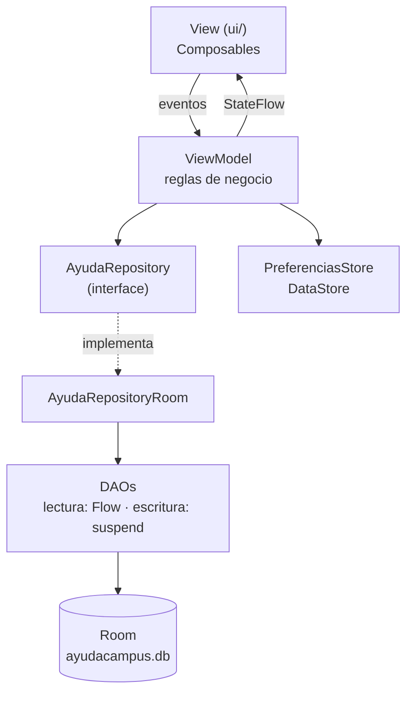

# Lab 08 - AyudaCampus: mesa de ayuda TI del campus (MVVM + Room)

**Nombre:** Willard Guillermo
**Curso:** Programación en Móviles - 4to Ciclo
**Docente:** Juan León S.

## Descripción
AyudaCampus es la mesa de ayuda de TI de un campus con dos perfiles en el mismo dispositivo.
El **Estudiante** reporta incidencias (Wi-Fi, equipos, cuentas), conversa con soporte y califica la atención.
El personal de **Soporte TI** atiende los tickets, cambia su estado y prioridad, responde y administra las categorías.
Ambos perfiles comparten la misma base de datos Room, así que los cambios de uno se ven al instante en el otro gracias a `Flow`.

## Tecnologías
- Kotlin + Jetpack Compose + Material 3 (sin XML)
- Room 2.8.4 con KSP (entidades, relaciones, `@Transaction`, JOIN y COUNT)
- DataStore Preferences (perfil activo, modo oscuro, notificaciones, recibir tickets)
- Navigation Compose con un grafo por perfil
- Arquitectura MVVM + Repository (interface)

> Se usó Room 2.8.4 y KSP 2.3.6 en lugar de Room 2.6.1 porque el proyecto usa AGP 9 y Kotlin 2.2, que traen Kotlin integrado. El código de Room es el mismo.

## Cuentas de prueba
| Perfil | Correo | Contraseña |
|---|---|---|
| Estudiante | juan@campus.test | 1234 |
| Soporte TI | soporte@campus.test | admin |

## Arquitectura MVVM


| Capa | Conoce a | No debe |
|---|---|---|
| View (ui/) | Solo a su ViewModel | Usar DAO, Repository ni reglas de negocio |
| ViewModel | Solo al Repository (interface) | Conocer Composables ni el DAO |
| Repository | Los DAOs | Conocer pantallas ni ViewModels |
| DAO / Room | SQL y entidades | Conocer ViewModels |

## Estructura de paquetes
```
com.tecsup.ayudacampus
├── AyudaApp.kt
├── MainActivity.kt
├── data
│   ├── local
│   │   ├── AyudaDatabase.kt
│   │   ├── DatosIniciales.kt
│   │   ├── dao/         CategoriaDao, UsuarioDao, TicketDao
│   │   ├── entity/      Categoria, Usuario, Ticket, Comentario
│   │   └── relation/    TicketConDetalle
│   ├── prefs/           PreferenciasStore
│   └── repository/      AyudaRepository, AyudaRepositoryRoom
├── model/               Rol, EstadoTicket, Prioridad, ConteoCategoria
├── viewmodel/           AyudaViewModelFactory, SesionViewModel, MisTicketsViewModel,
│                        NuevoTicketViewModel, TicketDetalleViewModel, PerfilViewModel,
│                        PanelViewModel, BandejaViewModel, AtenderViewModel, CategoriasViewModel
└── ui
    ├── theme/           Color, Type, Theme (AyudaTheme por rol)
    ├── components/      AppTopBar, AyudaButton, AyudaTextField, EstadoChip, PrioridadChip,
    │   │                TicketCard, BurbujaComentario, StepperTicket, Estrellas,
    │   │                Formatos, ComponentesPerfil
    │   └── graficos/    DatoGrafico, GraficoDona, GraficoBarras
    ├── navigation/      Rutas, NavAyuda
    ├── cliente/         SplashScreen, LoginScreen, MisTicketsScreen, NuevoTicketScreen,
    │                    DetalleTicketScreen, PerfilScreen
    └── soporte/         PanelScreen, BandejaScreen, AtenderTicketScreen, CategoriasScreen,
                         FormularioCategoriaScreen, AjustesScreen
```

## Base de datos
| Tabla | Relación |
|---|---|
| usuarios | — |
| categorias | — |
| tickets | N tickets → 1 cliente · N tickets → 1 categoría |
| comentarios | N comentarios → 1 ticket (`onDelete = CASCADE`) |

## Reglas de negocio (en los ViewModels)
- El estudiante solo ve sus tickets; Soporte ve todos.
- Nuevo ticket: título ≥ 5, descripción ≥ 10 y categoría activa. Prioridad MEDIA por defecto y estado ABIERTO.
- Soporte puede dejar el ticket en ABIERTO, EN_PROCESO o RESUELTO, pero no puede cerrarlo.
- El estudiante cierra solo si está RESUELTO y con calificación de 1 a 5; reabrir borra la calificación.
- No se puede comentar un ticket CERRADO.
- Bandeja ordenada por prioridad ALTA → MEDIA → BAJA y luego por fecha.
- La alerta del panel cuenta los tickets ALTA abiertos con más de 1 hora.

## Capturas

### Estudiante


 


### Soporte TI


## Pruebas de aceptación
| Prueba | Resultado esperado | OK |
|---|---|---|
| Login con clave incorrecta | Mensaje de error, no entra | ✅ |
| Estudiante: crear ticket vacío | Errores junto a cada campo, no se crea | ✅ |
| Estudiante: crear ticket válido | Aparece en Mis tickets como ABIERTO con la prioridad elegida | ✅ |
| Soporte: bandeja | El ticket nuevo aparece; los de prioridad Alta salen primero | ✅ |
| Soporte: pasar a En proceso y responder | El estudiante ve el nuevo estado y la respuesta sin reiniciar | ✅ |
| Soporte: intentar cerrar un ticket | La opción Cerrado está deshabilitada | ✅ |
| Soporte: marcar Resuelto | El estudiante ve el aviso verde, califica con 4 estrellas y cierra | ✅ |
| Estudiante: reabrir un ticket resuelto | Vuelve a Abierto y se borra la calificación | ✅ |
| Comentar en un ticket cerrado | El campo no aparece | ✅ |
| Panel | Contadores y gráficos coinciden con la bandeja; la alerta cuenta las ALTA abiertas con más de 1 hora | ✅ |
| Desactivar una categoría | Ya no se puede elegir al crear un ticket | ✅ |
| Cerrar y abrir la app | Los tickets siguen ahí y el perfil y el modo oscuro se recuerdan | ✅ |

## Para pensar
1. **Reglas en el ViewModel:** son lógica de negocio; el DAO solo guarda datos y el Composable solo dibuja, así la regla vive en un solo lugar y no depende de la pantalla ni del SQL.
2. **suspend vs Flow:** `crearTicket` es una acción única que se ejecuta y termina, y `observarTicket` es una lectura que debe avisar cada vez que el ticket cambia en Room.
3. **Cerrar sin calificación:** se perdería la confirmación del estudiante de que el problema se solucionó y la mesa de ayuda no podría medir la calidad de su atención.
4. **Tickets en un servidor:** solo cambiaría la implementación del Repository (por ejemplo, una versión con Retrofit); los ViewModels y las pantallas siguen igual porque dependen de la interface.
